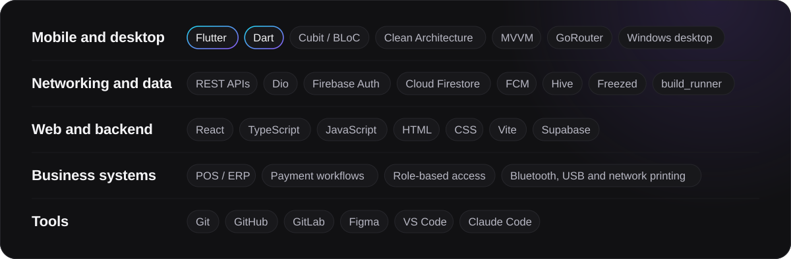
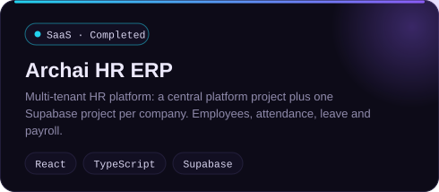
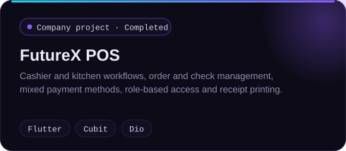
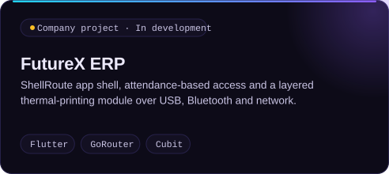
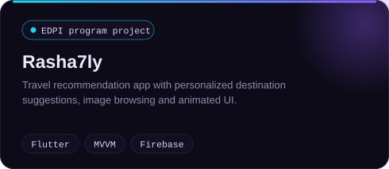
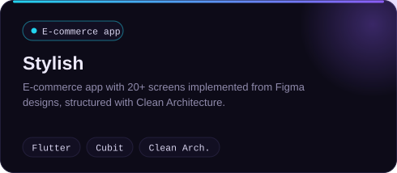
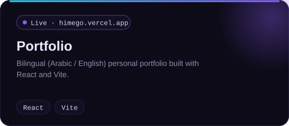
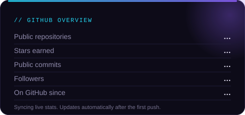
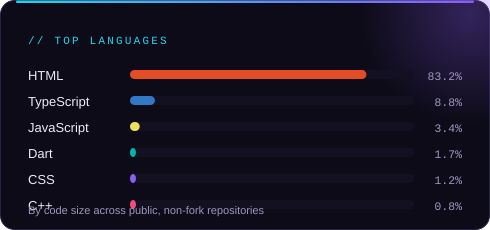

 

 

## About

I'm a software engineer from Egypt who specializes in **Flutter and Dart**. I build mobile and Windows desktop applications for real business workflows: orders, payments, role-based access, receipt printing and API-driven back offices.

I care about codebases that stay maintainable. I structure apps with **Clean Architecture** and **Cubit / BLoC**, integrate REST APIs with **Dio** (interceptors, refresh tokens, session handling), and use **Firebase** and **Hive** when an app needs cloud sync or offline-first behavior. On the web, I build with **React, TypeScript and Supabase**.

**Right now**

- Building Flutter mobile and desktop applications for POS and ERP products at **FutureX**
- Leading technical direction at **Archai Solutions**, the early-stage software company I founded
- Open to **remote** Flutter, Mobile Developer and Software Engineer roles

 

## Tech Stack

  

 

## Featured Work

  
  
  
  
  
  

FutureX projects are private company work, so their source code is not public. Click Archai HR ERP or Portfolio to open them.

 

## Experience

| Role | Where | Period |
| :-- | :-- | :-- |
| **Mobile & Desktop App Developer** (Flutter) | FutureX | Mar 2026 – Present |
| **Founder & CEO** | Archai Solutions | Jun 2026 – Present |
| **Freelance Mobile & Software Developer** | Self-employed | Jan 2024 – Present |

**Education:** Bachelor's Degree, Higher Technological Institute, Beni Suef (2026)

 

## GitHub Stats

  
  

Generated by a GitHub Action in this repository and refreshed daily. No third-party service is involved.

 

## Let's Connect

I'm looking for remote opportunities where I can build Flutter and software products with a strong engineering team.

- **Email:** [ibrahimmohamed09854@gmail.com](mailto:ibrahimmohamed09854@gmail.com)
- **LinkedIn:** [linkedin.com/in/ibrahim-mohamedx](https://www.linkedin.com/in/ibrahim-mohamedx)
- **Portfolio:** [himego.vercel.app](https://himego.vercel.app/)
- **Archai Solutions:** [archai-showcase.web.app](https://archai-showcase.web.app/) · [GitHub organization](https://github.com/Archai-Solution)
