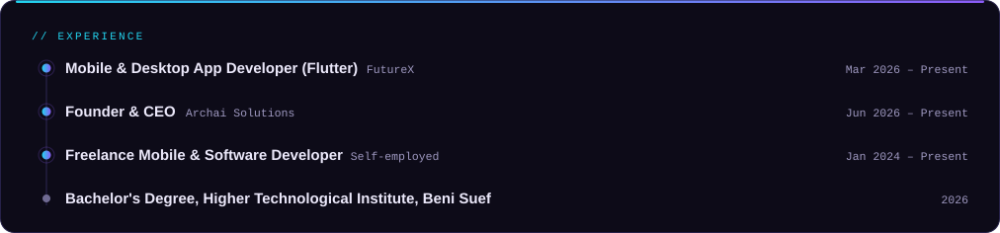

<picture><source media="(max-width: 640px)" srcset="assets/sm/banner.svg" /></picture>

## About

I'm a software engineer from Egypt who specializes in **Flutter and Dart**. I build mobile and Windows desktop apps for real business workflows: orders, payments, role-based access, receipt printing and API-driven back offices.

I care about code that stays maintainable. Apps are structured with **Clean Architecture** and **Cubit / BLoC**, REST APIs go through **Dio** (interceptors, refresh tokens, session handling), and **Firebase** and **Hive** cover cloud sync and offline-first behavior. On the web I build with **React, TypeScript and Supabase**.

**Right now**

- Building Flutter mobile and desktop apps for POS and ERP products at **FutureX**
- Leading technical direction at **Archai Solutions**, the early-stage software company I founded
- Open to **remote** Flutter, mobile and software engineering roles

نبذة بالعربي

 

مهندس برمجيات من مصر، متخصص في **Flutter وDart**. بابني تطبيقات موبايل وديسكتوب لأنظمة حقيقية: أوردرات، مدفوعات، صلاحيات للمستخدمين وطباعة إيصالات. شغال حاليًا في **FutureX** على أنظمة POS وERP، وبقود الجانب التقني في **Archai Solutions** اللي أسستها. مهتم بفرص العمل عن بُعد.

 

## Selected work

  <a href="https://github.com/ibrahimMohamedX/hr-erp"><picture><source media="(max-width: 640px)" srcset="assets/sm/work-hr-erp.svg" /></picture></a>

  <picture><source media="(max-width: 640px)" srcset="assets/sm/work-futurex-pos.svg" /></picture>

  <picture><source media="(max-width: 640px)" srcset="assets/sm/work-futurex-erp.svg" /></picture>

  <a href="https://github.com/ibrahimMohamedX/Rasha7ly-App"><picture><source media="(max-width: 640px)" srcset="assets/sm/work-rasha7ly.svg" /></picture></a>

  <a href="https://github.com/ibrahimMohamedX/Stylish-App"><picture><source media="(max-width: 640px)" srcset="assets/sm/work-stylish.svg" /></picture></a>

  <a href="https://himego.vercel.app/"><picture><source media="(max-width: 640px)" srcset="assets/sm/work-portfolio.svg" /></picture></a>

FutureX projects are private company work, so their source is not public. Archai HR ERP, Rasha7ly, Stylish and the portfolio open on click.

 

## Stack

  <picture><source media="(max-width: 640px)" srcset="assets/sm/stack.svg" /></picture>

 

## Experience

  <picture><source media="(max-width: 640px)" srcset="assets/sm/experience.svg" /></picture>

 

## GitHub in numbers

  <picture><source media="(max-width: 640px)" srcset="assets/sm/github.svg" /></picture>

Generated by a GitHub Action in this repository and refreshed daily. No third-party service is involved.

 

## Get in touch

  <picture><source media="(max-width: 640px)" srcset="assets/sm/contact.svg" /></picture>

- **Email:** [ibrahimmohamed09854@gmail.com](mailto:ibrahimmohamed09854@gmail.com)
- **LinkedIn:** [linkedin.com/in/ibrahim-mohamedx](https://www.linkedin.com/in/ibrahim-mohamedx)
- **Portfolio:** [himego.vercel.app](https://himego.vercel.app/)
- **Archai Solutions:** [archaisolutions.vercel.app](https://archaisolutions.vercel.app) and the [GitHub organization](https://github.com/Archai-Solution)
